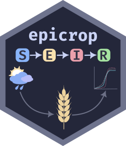

<!-- README.md is generated from README.Rmd. Please edit that file -->

```{r, include = FALSE}
knitr::opts_chunk$set(
  collapse = TRUE,
  comment = "#>",
  fig.path = "man/figures/README-",
  out.width = "100%"
)
```

# {epicrop} Simulation Modelling of Crop Diseases Using a Susceptible-Exposed-Infectious-Removed (seir()) Model 

<!-- badges: start -->

[](https://www.repostatus.org/#active) [](https://lifecycle.r-lib.org/articles/stages.html#stable) [](https://zenodo.org/badge/latestdoi/58613738) [](https://CRAN.R-project.org/package=epicrop)

<!-- badges: end -->

A fork of [{cropsim}](https://github.com/r-forge/cropsim/tree/master/pkg/cropsim) (Hijmans *et al.* 2009) designed to make using the EPIRICE model (Savary *et al.* 2012) for rice diseases easier to use.
This version provides easy to use functions to fetch weather data from NASA POWER, via the [{nasapower}](https://cran.r-project.org/package=nasapower) package (Sparks 2018, Sparks 2020) and predict disease intensity of five rice diseases using a generic seir() model (Zadoks 1971) function, `seir()()`.

The original EPIRICE manuscript, Savary *et al.* (2012), which details the model and results of its use to model global epidemics of rice diseases, was published in *Crop Protection* detailing global unmanaged disease risk of bacterial blight, brown spot, leaf blast, sheath blight and rice tungro, which are included in this package.

# Quick start

You can easily simulate any of the five diseases for rice grown anywhere in the world for years from 1983 to near current using `get_wth()` to fetch data from the [NASA POWER web API](https://power.larc.nasa.gov).
Alternatively, you can supply your own weather data for any time period as long as it fits the model’s requirements.

{epicrop} is not yet on CRAN.
You can install it this way.

The preferred method is using {remotes} for simplicity.

```r 
if (!require("remotes")) {
  install.packages("remotes")
}
remotes::install_git("https://codeberg.org/adamhsparks/epicrop.git",
                      dependencies = TRUE,
                      build_manual = TRUE,
                      build_vignettes = TRUE)
```

However, if you prefer to use {pak} you can do it this way.
It may be faster to install and for Linux users, it can often help by installing system-level packages necessary to build some of the dependencies.

```{r eval=FALSE}
o <- options() # capture default options

options(pkg.build_vignettes = TRUE)

if (!require("pak")) {
  install.packages("pak",
    repos = sprintf(
      "https://r-lib.github.io/p/pak/stable/%s/%s/%s",
      .Platform$pkgType, R.Version()$os, R.Version()$arch
    )
  )
}

pak::pkg_install("git::https://codeberg.org/adamhsparks/epicrop")

options(o) # reset options
```

## Get weather data

First you need to provide weather data for the model; {epicrop} provides the `get_wth()` function to do this.
Using it you can fetch weather data for any place in the world from 1983 to near present by providing the and latitude and dates or length of rice growing season as shown below.

```{r weather}
library(epicrop)

# Fetch weather for year 2000 wet season for a 120 day rice variety at the IRRI
# Zeigler Experiment Station
wth <- get_wth(
  lonlat = c(121.25562, 14.6774),
  dates = "2000-07-01",
  duration = 120
)

wth
```

## Modelling bacterial blight disease intensity

Once you have the weather data, run the model for any of the five rice diseases by providing the emergence or crop establishment date for transplanted rice.

```{r example}
bb_sim <- bacterial_blight(wth, emergence = "2000-07-01")

bb_sim
```

Lastly, you can visualise the result of the model run.

```{r plot, fig.cap="Bacterial blight disease progress over time. Results for wet season year 2000 at IRRI Zeigler Experiment Station shown. Weather data used to run the model were obtained from the NASA Langley Research Center POWER Project funded through the NASA Earth Science Directorate Applied Science Program.",}
library(ggplot2)

ggplot(
  data = bb_sim,
  aes(
    x = dates,
    y = intensity
  )
) +
  labs(
    y = "Intensity",
    x = "Date"
  ) +
  geom_line() +
  geom_point() +
  theme_classic()
```

# Meta

-   Please [report any issues or bugs](https://codeberg.org/adamhsparks/epicrop/issues).

-   License: GPL-3

-   To cite {epicrop}, please use the output from `citation(package = "epicrop")`.

## Code of Conduct

Please note that the epicrop project is released with a [Contributor Code of Conduct](https://codeberg.org/adamhsparks/epicrop/src/branch/main/CODE_OF_CONDUCT.md).
By contributing to this project, you agree to abide by its terms.

# References

Robert J. Hijmans, Serge Savary, Rene Pangga and Jorrel Aunario.
(2009).
Simulation modeling of crops and their diseases.
R package version 0.2-6.

Serge Savary, Andrew Nelson, Laetitia Willocquet, Ireneo Pangga and Jorrel Aunario.(2012).
Modeling and mapping potential epidemics of rice diseases globally.
*Crop Protection*, Volume 34, Pages 6-17, ISSN 0261-2194 DOI: [10.1016/j.cropro.2011.11.009](https://doi.org/10.1016/j.cropro.2011.11.009).

Serge Savary, Stacia Stetkiewicz, François Brun, and Laetitia Willocquet.
Modelling and Mapping Potential Epidemics of Wheat Diseases-Examples on Leaf Rust and Septoria Tritici Blotch Using EPIWHEAT.
(2015).
*European Journal of Plant Pathology* 142, no. 4:771–90.
DOI: [10.1007/s10658-015-0650-7](https://doi.org/10.1007/s10658-015-0650-7).

Adam Sparks (2018).
nasapower: A NASA POWER Global Meteorology, Surface Solar Energy and Climatology Data Client for R.
*Journal of Open Source Software*, 3(30), 1035, DOI: [10.21105/joss.01035](https://doi.org/10.21105/joss.01035).

Adam Sparks (2021).
*nasapower: NASA-POWER Data from R*.
DOI: [10.5281/zenodo.1040727](https://doi.org/10.5281/zenodo.1040727), R package version 4.0.0, URL: <https://CRAN.R-project.org/package=nasapower>.

Jan C. Zadoks.
(1971).
Systems Analysis and the Dynamics of Epidemics.
*Phytopathology* 61:600.
DOI: [10.1094/Phyto-61-600](https://doi.org/10.1094/Phyto-61-600).
