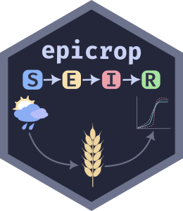
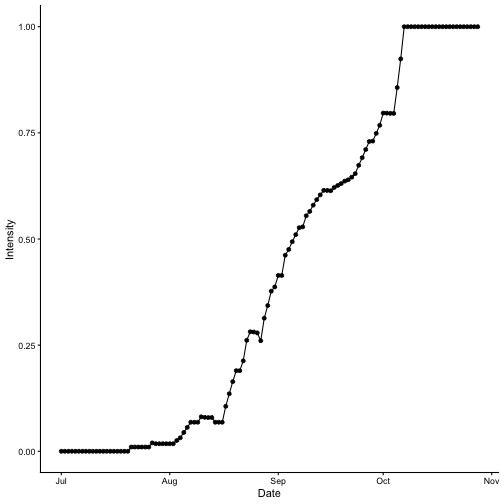

<!-- README.md is generated from README.Rmd. Please edit that file -->


# Simulation Modelling of Crop Diseases Using a Susceptible-Exposed-Infectious-Removed (SEIR) Model 

<!-- badges: start -->

[](https://www.repostatus.org/#active) [](https://lifecycle.r-lib.org/articles/stages.html#stable) [](https://zenodo.org/badge/latestdoi/58613738) [](https://CRAN.R-project.org/package=epicrop) [](#code-coverage)

<!-- badges: end -->

A fork of [{cropsim}](https://github.com/r-forge/cropsim/tree/master/pkg/cropsim) (Hijmans *et al.* 2009) designed to make using the EPIRICE model (Savary *et al.* 2012) for rice diseases easier to use and to implement the EPIWHEAT model in the same R package.
This version provides easy to use functions to fetch weather data from NASA POWER, via the [{nasapower}](https://cran.r-project.org/package=nasapower) package (Sparks 2018) and predict disease intensity of five rice diseases using a generic Susceptible-Exposed-Infectious-Removed (SEIR) model (Zadoks 1971) function, `seir()`.
The legacy `SEIR()` in {cropsim} uses a non-canonical formula for "diseased" ([it accumulates "infectious" twice via `sum(infectious)`](https://github.com/r-forge/cropsim/blob/7b7a035a612f9386112d8d49ec21724500d7f88e/pkg/cropsim/R/SEIR.R#L118C1-L120C60)).
The modern core of `seir()` in {epicrop} was changed to the canonical formula (`diseased = latent + infectious + removed`), which reduced modern diseased and COFR relative to legacy.
So, please be aware that the legacy `SEIR()` and the modern `seir()` will give different results for the same parameters, and that the modern `seir()` is more consistent with the canonical SEIR model.
This modern core of `seir()` is also now 1 indexed, which is more consistent with R's indexing and makes it easier to understand the model's parameters and outputs when developing new models based on this core.
The original `SEIR()` is 0 indexed, which is more consistent with the original EPIRICE model as presented in Savary *et al.* (2012) and the legacy `SEIR()` in {cropsim}.

This package implements the original EPIRICE model as detailed in Savary *et al.* (2012), which introduces the model and uses it to model global epidemics of rice diseases illustrating the risk of bacterial blight, brown spot, leaf blast, sheath blight and rice tungro disease.
Additional models included for rice are adapted from Kim *et al.* (2015) for rice sheath blight and leaf blast.

The original EPIWHEAT model as presented in Savary *et al.* (2015) is also included in this implementation and can be used to model potential epidemics of two wheat diseases, leaf rust and Septoria tritici blotch, is also included in this package.

Users may also provide their own parameters to the generic `seir()` function to simulate other crop diseases as long as the weather data provided meet the model's requirements.

# Quick start

{epicrop} is not yet on CRAN.
You can install it this way.

```r 
install.packages("epicrop",
  repos = c("https://adamhsparks.r-universe.dev",
            "https://cloud.r-project.org"))
```

## Get weather data

First you need to provide weather data for the model; {epicrop} provides the `get_wth()` function to do this.
Using it you can fetch weather data for any place in the world from 1983 to near present by providing the and latitude and dates or length of rice growing season as shown below.


``` r
library(epicrop)

# Fetch weather for year 2000 wet season for a 120 day rice variety at the IRRI
# Zeigler Experiment Station
wth <- get_wth(
  lonlat = c(121.25562, 14.6774),
  dates = "2000-07-01",
  duration = 120
)

wth
#> Key: <YYYYMMDD>
#>        YYYYMMDD   DOY  TEMP  TMIN  TMAX  RHUM  RAIN     LAT      LON
#>          <IDat> <int> <num> <num> <num> <num> <num>   <num>    <num>
#>   1: 2000-07-01   183 25.29 23.86 27.78 92.20 23.12 14.6774 121.2556
#>   2: 2000-07-02   184 26.13 23.54 29.90 86.01 17.34 14.6774 121.2556
#>   3: 2000-07-03   185 25.50 24.28 27.23 94.16 29.08 14.6774 121.2556
#>   4: 2000-07-04   186 25.81 24.50 27.56 92.42 13.01 14.6774 121.2556
#>   5: 2000-07-05   187 25.97 25.13 27.40 92.34 32.20 14.6774 121.2556
#>  ---                                                                
#> 117: 2000-10-25   299 25.82 23.44 29.54 89.76 12.04 14.6774 121.2556
#> 118: 2000-10-26   300 25.44 24.14 26.99 94.93 13.03 14.6774 121.2556
#> 119: 2000-10-27   301 25.74 24.54 27.69 91.43 11.54 14.6774 121.2556
#> 120: 2000-10-28   302 25.44 24.72 26.62 91.90 74.20 14.6774 121.2556
#> 121: 2000-10-29   303 24.97 24.15 26.34 94.15 29.11 14.6774 121.2556
```

## Modelling bacterial blight disease intensity

Once you have the weather data, run the model for any of the five rice diseases by providing the emergence or crop establishment date for transplanted rice.


``` r
bb_sim <- bacterial_blight(wth, emergence = "2000-07-01")

bb_sim
#>      simday      dates sites latent infectious  removed senesced rateinf  rlex
#>       <int>     <IDat> <num>  <num>      <num>    <num>    <num>   <num> <num>
#>   1:      1 2000-07-01   100      0   0.000000  0.00000  0.00000       0     0
#>   2:      2 2000-07-02   100      0   0.000000  0.00000  0.00000       0     0
#>   3:      3 2000-07-03   100      0   0.000000  0.00000  0.00000       0     0
#>   4:      4 2000-07-04   100      0   0.000000  0.00000  0.00000       0     0
#>   5:      5 2000-07-05   100      0   0.000000  0.00000  0.00000       0     0
#>  ---                                                                          
#> 116:    116 2000-10-24     0      0   6.717905 56.35040 57.27858       0     0
#> 117:    117 2000-10-25     0      0   5.789721 57.27858 57.93887       0     0
#> 118:    118 2000-10-26     0      0   5.129435 57.93887 58.55975       0     0
#> 119:    119 2000-10-27     0      0   4.508549 58.55975 59.28986       0     0
#> 120:    120 2000-10-28     0      0   3.778446 59.28986 60.01366       0     0
#>      rtransfer  rremoved rgrowth rsenesced diseased intensity     lat      lon
#>          <num>     <num>   <num>     <num>    <num>     <num>   <num>    <num>
#>   1:         0 0.0000000       0 0.0000000   0.0000         0 14.6774 121.2556
#>   2:         0 0.0000000       0 0.0000000   0.0000         0 14.6774 121.2556
#>   3:         0 0.0000000       0 0.0000000   0.0000         0 14.6774 121.2556
#>   4:         0 0.0000000       0 0.0000000   0.0000         0 14.6774 121.2556
#>   5:         0 0.0000000       0 0.0000000   0.0000         0 14.6774 121.2556
#>  ---                                                                          
#> 116:         0 0.0000000       0 0.9281842 119.4187         1 14.6774 121.2556
#> 117:         0 0.9281842       0 0.6602855 120.3469         1 14.6774 121.2556
#> 118:         0 0.6602855       0 0.6208868 121.0072         1 14.6774 121.2556
#> 119:         0 0.6208868       0 0.7301022 121.6281         1 14.6774 121.2556
#> 120:         0 0.7301022       0 0.7238054 122.3582         1 14.6774 121.2556
```

Lastly, you can visualise the result of the model run.


``` r
library(ggplot2)

ggplot(
  data = bb_sim,
  aes(
    x = dates,
    y = intensity
  )
) +
  labs(
    y = "Intensity",
    x = "Date"
  ) +
  geom_line() +
  geom_point() +
  theme_classic()
```

<div class="figure">

<p class="caption">Bacterial blight disease progress over time. Results for wet season year 2000 at IRRI Zeigler Experiment Station shown. Weather data used to run the model were obtained from the NASA Langley Research Center POWER Project funded through the NASA Earth Science Directorate Applied Science Program.</p>
</div>

# Meta

-   Please [report any issues or bugs](https://codeberg.org/adamhsparks/epicrop/issues).

-   License: GPL-3

-   To cite {epicrop}, please use the output from `citation(package = "epicrop")`.

## Code Coverage


```
#> epicrop Coverage: 57.68%
#> R/build_epicrop_emergence.R: 0.00%
#> R/fetch_epicrop_weather_list.R: 0.00%
#> R/run_epicrop_model.R: 0.00%
#> R/validation.R: 10.00%
#> R/seir.R: 77.40%
#> R/interpolation.R: 77.78%
#> R/get_wth.R: 81.16%
#> R/format_wth.R: 93.15%
#> R/leaf_wetness.R: 97.22%
#> R/audpc.R: 98.28%
#> R/disease_models.R: 100.00%
```

## Code of Conduct

Please note that the epicrop project is released with a [Contributor Code of Conduct](https://codeberg.org/adamhsparks/epicrop/src/branch/main/CODE_OF_CONDUCT.md).
By contributing to this project, you agree to abide by its terms.

## Other Implementations in R

 - The EPIRICE model was originally written in R as a part of the [{cropsim}](https://github.com/r-forge/cropsim/tree/master/pkg/cropsim) package (Hijmans _et al._ 2009).

 - The EPIRICE model is also available from CRAN in the [{ZeBook}](https://cran.r-project.org/package=ZeBook) package (Brun _et al._ 2018) to accompany, "Working with dynamic crop models: methods, tools and examples for agriculture and environment" (Wallach _et al._ 2018).

# References
Brun François, David Makowski, Daniel Wallach, and James W Jones.
(2018).
*ZeBook: Working with Dynamic Models for Agriculture and Environment*.
DOI: [10.32614/CRAN.package.ZeBook](https://doi.org/10.32614/CRAN.package.ZeBook) 
R package version 1.1, <https://CRAN.R-project.org/package=ZeBook>.

Kwang-Hyung Kim, Jaepil Cho, Yong Hwan Lee, and Woo-Seop Lee.
(2015).
Predicting potential epidemics of rice leaf blast and sheath blight in South Korea.
*Agricultural and Forest Meteorology*, 203: 191-207.
DOI: [10.1016/j.agrformet.2015.01.011](https://doi.org/10.1016/j.agrformet.2015.01.011)

Robert J. Hijmans, Serge Savary, Rene Pangga and Jorrel Aunario.
*cropsim*.
(2009).
Simulation modeling of crops and their diseases.
R package version 0.2-6.

Serge Savary, Andrew Nelson, Laetitia Willocquet, Ireneo Pangga and Jorrel Aunario.
(2012).
Modeling and mapping potential epidemics of rice diseases globally.
*Crop Protection*, Volume 34, Pages 6-17, ISSN 0261-2194 DOI: [10.1016/j.cropro.2011.11.009](https://doi.org/10.1016/j.cropro.2011.11.009).

Serge Savary, Stacia Stetkiewicz, François Brun, and Laetitia Willocquet.
Modelling and Mapping Potential Epidemics of Wheat Diseases-Examples on Leaf Rust and Septoria Tritici Blotch Using EPIWHEAT.
(2015).
*European Journal of Plant Pathology* 142, no. 4:771–90.
DOI: [10.1007/s10658-015-0650-7](https://doi.org/10.1007/s10658-015-0650-7).

Adam Sparks.
(2018).
nasapower: A NASA POWER Global Meteorology, Surface Solar Energy and Climatology Data Client for R.
*Journal of Open Source Software*, 3(30), 1035, DOI: [10.21105/joss.01035](https://doi.org/10.21105/joss.01035).

Jan C. Zadoks.
(1971).
Systems Analysis and the Dynamics of Epidemics.
*Phytopathology* 61:600.
DOI: [10.1094/Phyto-61-600](https://doi.org/10.1094/Phyto-61-600).

Wallach, Daniel, David Makowski, James W. Jones, and François Brun.
(2018)
_Working with dynamic crop models: methods, tools and examples for agriculture and environment_. Academic Press.
DOI: [10.1016/C2016-0-01552-8](https://doi.org/10.1016/C2016-0-01552-8).
