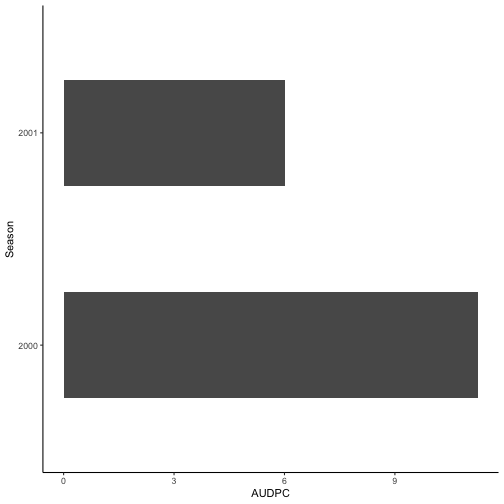

<!-- STOP! Do not edit this file. This file is generated from multiples.Rmd.orig -->


You may wish to compare the effects of different establishment dates, different seasons or different locations on disease levels.
This vignette details how you can automate several runs of {epicrop} in R and visualise them.

### Fetching NASA POWER data for multiple seasons

Start by creating a list of the dates representing the seasons that you want to simulate.
In this case, since we specify the duration of the season, there is no need to explicitly state the end-date, that will automatically be determined by `get_wth()` with the `duration` argument that we pass along in the `purrr::map()`.
You can use as many start dates, representing as many seasons as you desire, but for the purposes of speed in this vignette, only two will be used.

Use `build_epicrop_emergence()` and `fetch_epicrop_weather_list()` to fetch the weather data from the [POWER API](https://power.larc.nasa.gov).
In this example we will use the IRRI Zeigler Experiment Station coordinates as shown in the example for `get_wth()`.


``` r
library(epicrop)

years <- 2000:2001
emergence_date <- "06-30"
duration <- 120L

ymd <- build_epicrop_emergence(years = years, month_day = emergence_date)
```

A helper function, `fetch_epicrop_weather_list()`, is provided to simplify fetching multiple years of weather data from NASA POWER that uses very similar arguments to `get_wth()`.
Note that since we only need the starting date as we have supplied `duration`, that the argument is rather `start_date`, a single value, not `dates`.
The function uses the `duration` value to fetch the necessary weather data for all years and start dates inclusive of the end of the last season of the last start date.


``` r
wth_list <- fetch_epicrop_weather_list(
  years = years,
  lonlat = c(121.255669, 14.16742),
  start_date = emergence_date,
  duration = duration
)
```

### Using a Helper Function to Model Several Seasons

Now that we have a list of weather data for two seasons we will use `run_epicrop_model()` now to run `bacterial_blight()` for two seasons and create a single data frame of the two seasons.


``` r
bb_2_seasons <- run_epicrop_model(model_fun = bacterial_blight,
                                  emergence_date = ymd,
                                  wth_list = wth_list,
                                  window_days = duration)
#> Warning in run_epicrop_model(model_fun = bacterial_blight, emergence_date = ymd, : partial argument
#> match of 'emergence_date' to 'emergence_dates'

bb_2_seasons
#> Key: <emergence, AUDPC>
#>           emergence    AUDPC
#>    <epicrop.emerge>    <num>
#> 1:       2000-06-30 33.35499
#> 2:       2001-06-30 23.27681
```

### Visualising differences in AUDPC between seasons

A simple bar chart created using {ggplot2} is an effective way to visualise the difference between the two seasons.


``` r
library(ggplot2)
ggplot(bb_2_seasons,
       aes(y = as.factor(emergence),
           x = AUDPC)) +
  geom_col(width = 0.5,
           orientation = "y") +
  ylab("Emergence (YYYY-MM-DD)") +
  xlab("AUDPC") +
  theme_classic()
```



### Simulating multiple seasons and establishment dates

#### Single Site with Multiple Dates

A helper function, `run_epicrop_model()` is provided to simplify running multiple establishment dates.


``` r
years <- 2001:2020
month_day <- c("-06-01", "-06-14", "-06-30")
lonlat <- c(121.255669, 14.16742)
duration <- 120L

emergence <- build_epicrop_emergence(years, month_day)

# select 200 days duration to allow for multiple seasonal runs on same data
wth_list <- fetch_epicrop_weather_list(years = years,
                                       lonlat = lonlat,
                                       start_date = month_day,
                                       duration = duration)
```


``` r
 run_epicrop_model(bacterial_blight,
                   emergence,
                   wth_list,
                   window_days = duration,
                   output = "audpc")
#> Key: <emergence, AUDPC>
#>            emergence    AUDPC
#>     <epicrop.emerge>    <num>
#>  1:       2001-06-01 37.63796
#>  2:       2001-06-14 33.40447
#>  3:       2001-06-30 23.27681
#>  4:       2002-06-01 34.64894
#>  5:       2002-06-14 35.23461
#>  6:       2002-06-30 36.63927
#>  7:       2003-06-01 33.33186
#>  8:       2003-06-14 35.91991
#>  9:       2003-06-30 40.34007
#> 10:       2004-06-01 36.58149
#> 11:       2004-06-14 42.66673
#> 12:       2004-06-30 29.54521
#> 13:       2005-06-01 35.46168
#> 14:       2005-06-14 32.94811
#> 15:       2005-06-30 37.34664
#> 16:       2006-06-01 42.72507
#> 17:       2006-06-14 42.46803
#> 18:       2006-06-30 33.49726
#> 19:       2007-06-01 23.53191
#> 20:       2007-06-14 22.14872
#> 21:       2007-06-30 27.12497
#> 22:       2008-06-01 27.30096
#> 23:       2008-06-14 27.03446
#> 24:       2008-06-30 31.68267
#> 25:       2009-06-01 22.10567
#> 26:       2009-06-14 26.35464
#> 27:       2009-06-30 25.97842
#> 28:       2010-06-01 34.74639
#> 29:       2010-06-14 40.28505
#> 30:       2010-06-30 38.72189
#> 31:       2011-06-01 35.82841
#> 32:       2011-06-14 39.77898
#> 33:       2011-06-30 47.11856
#> 34:       2012-06-01 42.56076
#> 35:       2012-06-14 42.03287
#> 36:       2012-06-30 45.05923
#> 37:       2013-06-01 39.65612
#> 38:       2013-06-14 40.31719
#> 39:       2013-06-30 41.29252
#> 40:       2014-06-01 27.77329
#> 41:       2014-06-14 28.63167
#> 42:       2014-06-30 27.68996
#> 43:       2015-06-01 18.65482
#> 44:       2015-06-14 23.87071
#> 45:       2015-06-30 29.73648
#> 46:       2016-06-01 27.79225
#> 47:       2016-06-14 24.87684
#> 48:       2016-06-30 27.06310
#> 49:       2017-06-01 33.85670
#> 50:       2017-06-14 30.61643
#> 51:       2017-06-30 27.47632
#> 52:       2018-06-01 41.48556
#> 53:       2018-06-14 40.73465
#> 54:       2018-06-30 32.12418
#> 55:       2019-06-01 29.61033
#> 56:       2019-06-14 28.35922
#> 57:       2019-06-30 32.35699
#> 58:       2020-06-01 23.17698
#> 59:       2020-06-14 19.87281
#> 60:       2020-06-30 22.84166
#>            emergence    AUDPC
#>     <epicrop.emerge>    <num>
```

#### Multiple Sites and Seasons

Multiple locations can also be simulated using `fetch_epicrop_weather_list()` and `run_epicrop_model()`.
Here Septoria tritici blotch is simulated for three locations in Western Australia and New South Wales over two seasons and two planting dates with a 240 day growing season.


``` r
# set up the dates
years <- 2020:2021
start_date <- c("04-15", "05-01")

# using a list of multiple locations
locs <- list(
  "Merredin" = c(x = 118.28, y = -31.48),
  "Corrigin" = c(x = 117.87, y = -32.33),
  "Tamworth" = c(x = 150.84, y = -31.07)
)

wth_list <- fetch_epicrop_weather_list(
  lonlat = locs,
  start_date = start_date,
  duration = 240L,
  years = years,
  mode = "cross"
  )

emergence <- build_epicrop_emergence(years, start_date)
```

Examples of how to run the model sequentially and in parallel.


``` r
run_epicrop_model(s_tritici_blotch,
                  emergence,
                  wth_list,
                  window_days = 240L,
                  output = "audpc")
#>            emergence     AUDPC location
#>     <epicrop.emerge>     <num>   <char>
#>  1:       2020-04-15  7.674841 Merredin
#>  2:       2020-05-01  4.031927 Merredin
#>  3:       2021-04-15 12.952039 Merredin
#>  4:       2021-05-01  7.472121 Merredin
#>  5:       2020-04-15  7.309789 Corrigin
#>  6:       2020-05-01  4.547591 Corrigin
#>  7:       2021-04-15 12.922422 Corrigin
#>  8:       2021-05-01  6.902683 Corrigin
#>  9:       2020-04-15  1.736335 Tamworth
#> 10:       2020-05-01  1.644464 Tamworth
#> 11:       2021-04-15  3.699709 Tamworth
#> 12:       2021-05-01  2.487648 Tamworth
```
